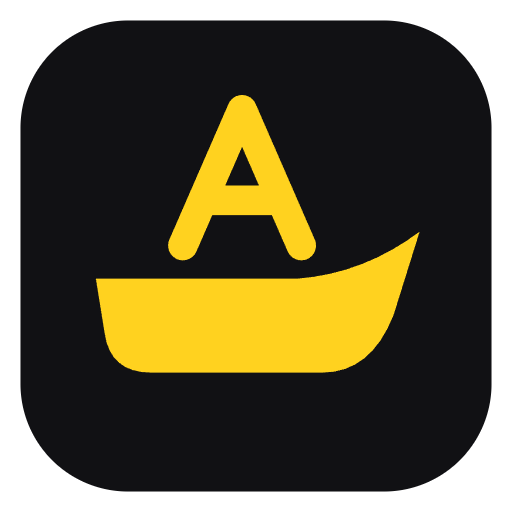
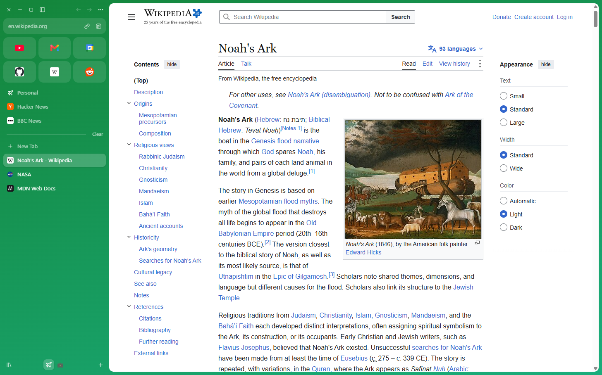
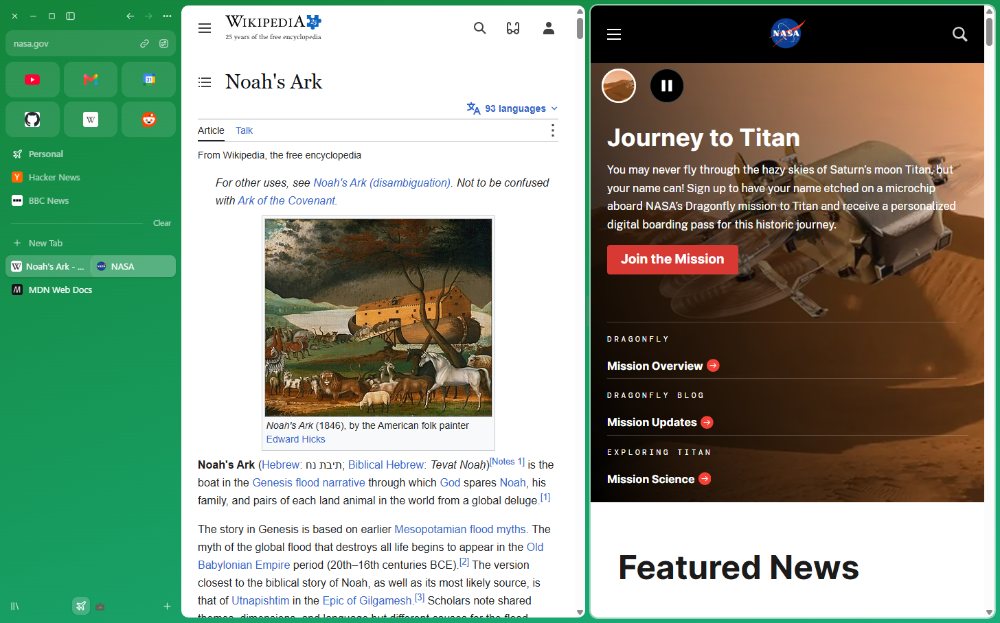
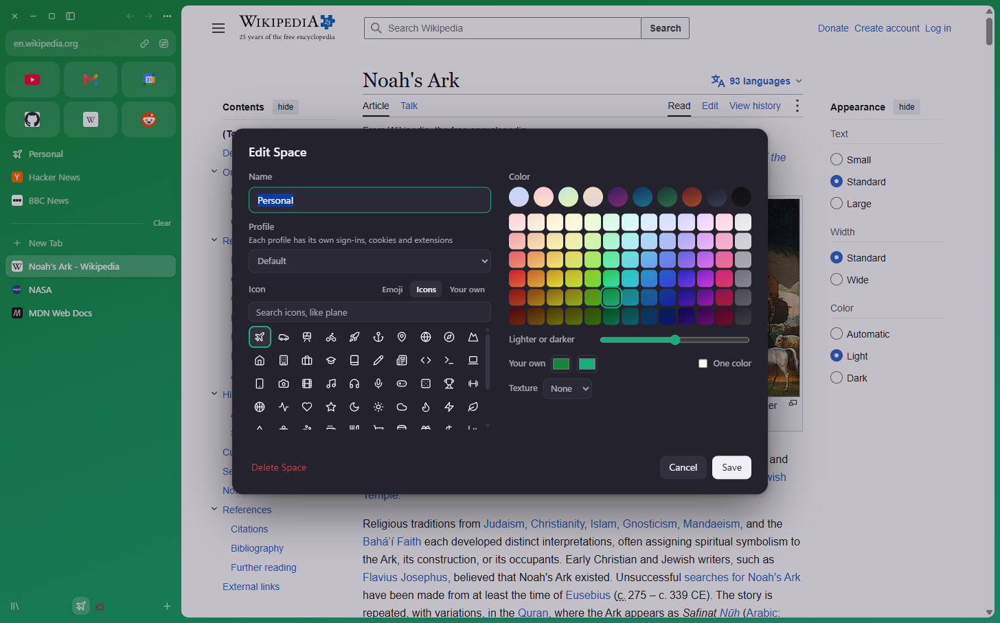
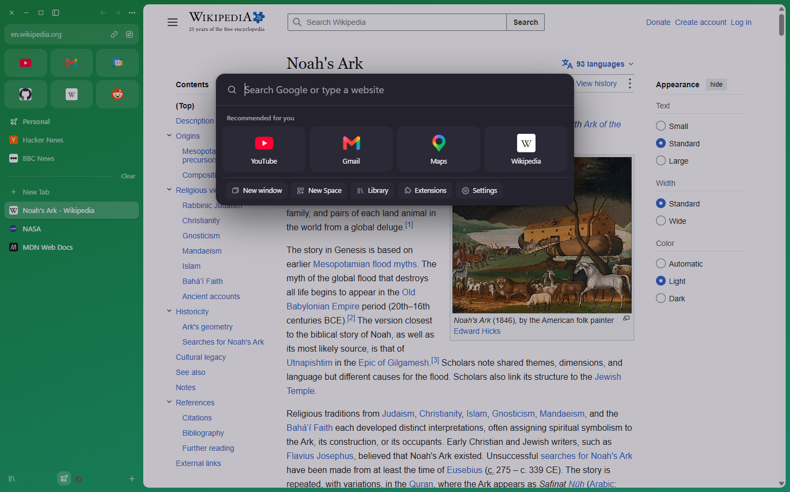

  

<h1 align="center">Noah's Ark</h1>

A web browser built around a sidebar, with Spaces to keep your tabs apart. For Mac and Windows.

<a href="https://noahs-ark.starktech.workers.dev"><b>Website</b></a> · <a href="../../releases/latest"><b>Download the latest version</b></a>

  

## Download

Get it from **[the website](https://noahs-ark.starktech.workers.dev)** or **[the latest release here](../../releases/latest)**. Those are the only official places to download it.

On a Mac you drag it to Applications. On Windows you click Install. Because it isn't signed with a paid Apple or Microsoft certificate, your computer warns you the first time, and both pages show what to click.

The source code isn't public. This repo is here to say what it does, and to take bug reports and ideas.

## What it does

**Tabs that stay out of your way**

- A sidebar instead of a tab bar, which you can resize or hide
- Spaces, each with its own tabs, colors and icon
- Favorites and pinned tabs that stay put, and folders to sort them into
- Open tabs that tidy themselves away when you haven't used them for a while
- Live Folders that fill themselves from a site's feed or a GitHub repo

**Seeing more than one thing**

- Split View, with up to four pages side by side
- Peek, for a quick look at a link without opening a tab
- Little Ark, a small floating window for links from other apps
- Rules that send certain sites straight to the right Space

**Making it yours**

- Any color or shade, with emoji, plain icons or your own pictures, for each Space
- Your own icon on any favorite or pinned tab
- Boosts, to change how a site looks
- Profiles, to keep sign-ins and extensions separate
- Chrome extensions, from the Chrome Web Store
- Keyboard shortcuts you can change

**The rest of the kit**

- A command bar for searching, opening and switching
- Picture in picture and a mini player in the sidebar
- Easels, Notes and screen capture with markup
- Updates itself

  
  

  

## Works on

- Mac with an Apple chip
- Windows (64-bit)

It's built on Chromium, through Electron.

## Bugs and ideas

[Open an issue](../../issues/new/choose). Please don't post passwords or anything else private, because everything here is public.

## About

Noah's Ark is an independent project inspired by the Arc browser, which stops on December 22, 2026. It isn't made by or connected to The Browser Company.

© 2026 yahya613. All rights reserved.
